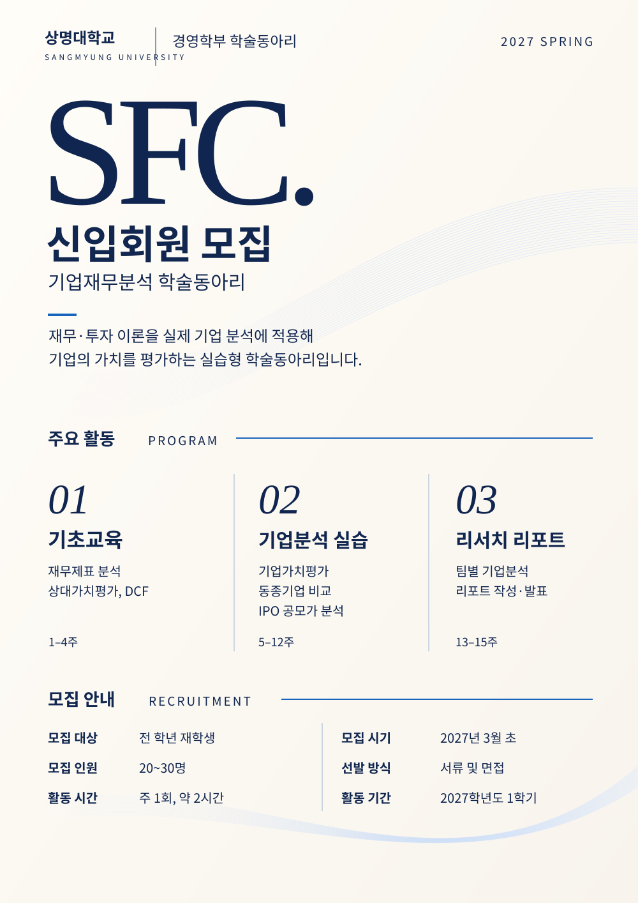

# CASE-EXT-001 · 상명대학교 기업재무분석 학술동아리 모집 포스터

- **기록일:** 2026-11-24
- **분류:** 외부 요청 기반 시각 디자인 / 정적 모집 포스터 / 첫 외부 의뢰 사례
- **발주 맥락:** 지인의 부탁으로 상명대학교 경영학부 기업재무분석 학술동아리 홍보 포스터 제작. 상업적 유상 외주라는 의미는 아님.
- **원자료:** 의뢰인이 전달한 《기업재무분석 학술동아리 1학기 운영 기획서》(2027학년도 1학기, 4쪽).
- **결정:** 여러 레이아웃과 다섯 색상안(A–E)을 비교한 뒤 **의뢰 측에서 D 색상안을 선택**함. 단, 인쇄·실제 게시·지원자 반응은 확인되지 않음.
- **이미지 정책:** 저장소에는 포스터 이미지/외부 레퍼런스 스크린샷을 올리지 않으며, 관찰·결정·출처만 기록한다. 기존 `IMAGE_POLICY.md` 유지.

## 1. 과업과 원자료

기획서의 핵심은 강의에서 배운 재무관리·투자론·기업가치평가를 상장기업에 적용하고, 팀별 조사·토론·발표를 거쳐 기업분석 리포트를 만드는 실습형 학술동아리이다.

- **정체성:** 상명대학교 경영학부의 기업재무분석 학술동아리, 명칭 후보 SFC(Sangmyung Financial Club).
- **대상/규모:** 전 학년 재학생, 20~30명, 4~5팀(팀당 5~6명).
- **일정:** 2027학년도 1학기 총 15주, 주 1회 약 2시간, 2027년 3월 초 모집 예정, 서류·면접, 3월 중순 첫 세션 계획.
- **1~4주:** 기초교육 — 재무제표 분석, 상대가치평가, DCF.
- **5~12주:** 팀별 케이스 — 바이사이드 밸류에이션, 산업/공시 리서치, 동종기업 비교, IPO 공모가 산정. 8주차는 중간고사 휴회.
- **13~15주:** 최종 기업분석 리포트(투자의견·적정주가·가정·리스크) 및 발표.
- **미확정:** 학회명, 정기 모임 요일, 장소, 모집 세부 날짜, 접수 채널, 교수·외부 연사 참여. 미래 계획을 확정된 성과로 표현하지 않음.

**표현 목표:** 보는 사람이 순서대로 ① 어떤 학회인가 ② 무엇을 배우고 수행하는가 ③ 언제·누가·어떻게 지원하는가를 빠르게 읽을 수 있게 한다. 운영 기획서의 모든 정보를 그대로 복제하지 않는다.

## 2. 참고 레퍼런스와 선택적 차용

다음은 대화에서 직접 사용자가 제시하거나 비교한 포스터다. 포스터 디자인을 통째로 복제한 것이 아니라 **기능·조형 원리만 선택적으로 참고**했다.

| 레퍼런스 | 관찰 / 차용 | 배제 |
|---|---|---|
| SURI 모집 포스터 | 투자 분야를 빠르게 인지시키는 강한 시각 정체성, 하단 모집 정보 분리 | 황소·곰·상승 그래프 등 직설적 장식, 손글씨 |
| BuySignal 2026 Spring Recruiting | 대형 학회명, 세리프/산세리프 위계, 넓은 여백, 정보 2열 | 과도한 검정 질감, 소형 본문 남용 |
| FIND-A 12기 | 간결한 큰 제목, 추상적으로 흐르는 배경, 정교한 그리드, 비교적 많은 정보를 균형 있게 배치 | 내용에 기여하지 않는 과한 효과 |
| ECOLLE 21기 | 밝은 에디토리얼 화면, 상단 소개/하단 모집 분리 | 맥락 없는 이미지 합성 |
| FRI 28기 | 절제된 학교 학회 브랜딩, 구조적인 모집 정보 | 본문 과밀, 불필요한 달력 반복 |

추가적으로 서울대·연세대·고려대의 금융/가치투자/기업재무학회(FIXERS, CFRC, YIG, KUVIC, IBC, KREDIT 등)를 탐색하며 모집 포스터의 전문성과 정보구조를 비교했다. 디자인 아틀라스의 Linear/Vercel/Notion/Plain/Visual/Programa 관련 원칙은 **타이포그래피, 위계, 간격, 편집 그리드** 참고로 다루었다. 특정 브랜드의 실제 UX 성능을 검증한 자료로 취급하지 않는다.

외부 이미지 파일과 폰트는 복제하지 않는다. 이 기록의 레퍼런스 표제는 대화 내 사용자 제공 이미지/조사 과정에 근거하며, 독립적으로 저작권·제작자를 확인한 상태는 아니다.

## 3. 제작·피드백 이력 (시간순)

| 단계 | 제안·시도 | 사용자 피드백 / 결정 | 디자인 판단 |
|---|---|---|---|
| 01 초기 탐색 | 명문대 금융학회 모집물 및 연합 가치투자학회 포스터 수집 | 더 유명한 연·고대 사례 요청, 실제 포스터 중심 비교 | 시각적 유행보다 **지원자에게 전달되는 내용** 우선 |
| 02 첫 생성 | 네이비·골드, 빌딩·차트 등 금융회사 광고형 A/B/C | “너무 화려함”, “AI 티”, 그림·미사여구 과다 | 장식 삭제, 학회 정체성과 활동을 첫 화면에 배치 |
| 03 과잉 단순화 | 흰 배경, 파란 카드/아이콘, 행정 안내형 | “너무 성의가 없는” 결과 | 단순함 ≠ 템플릿식 박스 반복 |
| 04 레퍼런스 재정의 | 사용자 제공 SURI/BuySignal/FIND-A/ECOLLE/FRI 다섯 이미지 분석 | 폰트·배치·정보 제시 방식 전체 재설계 요청 | 서체 위계, 비대칭 그리드, 편집 여백 우선 |
| 05 아틀라스 적용 | 타이포그래피/여백/12열 그리드/간격 규칙 참조 | A 기관형, B 에디토리얼, C 현대 금융형 개별 제작 | 색채보다 먼저 정보 위계와 읽기 흐름 설계 |
| 06 네 번째 D 배경 실험 | A/B/C 보완, D에 재무 수식·표 배경 | D의 배치는 긍정적이나 수식 배경은 부적합 | **실제 학술 내용을 가리는 배경 디테일**은 제거 |
| 07 A×D 절충 | A 정보량 + D 공간구성, FIND-A 유사한 흐르는 파형 도입 | 파형 방향 긍정, 모집 정보 확장 요청 | 배경은 보조적인 흐름/깊이감 제공 |
| 08 정보 확장 | 프로그램을 주차별 세로 타임라인, 모집안내를 상세 2열 구성 | “정보량이 너무 많아”; 3열 가로 프로그램 복귀, 아이콘 제거 | 과밀한 운영 안내보다 모집 포스터의 핵심정보 |
| 09 수직 균형 조정 | 상단 학교·소속·2027 SPRING은 고정, 나머지는 조금 아래로 이동 | 의도한 **세로형 포스터**에서 프로그램은 **가로 3열**로 유지 요구 | 포스터 방향과 콘텐츠 열 방향을 구분 |
| 10 실제 포스터 표현 | '(가칭)' 등 작업용 메모 삭제 | 실제 공개물처럼 보이도록 요청 | 편집 메모 제거; 미확정 일정 자체는 사실에 맞게 취급 |
| 11 색상 전면 실험 | 콘텐츠·위치 고정 원칙 아래 배경과 글자색 중심 A–E 비교 | **D 최종 선택** | 색상은 맥락과 가독성을 고려해 비교; 다른 영역 동시 변경 최소화 |

**실패로 남길 점**
1. 금융을 상징하는 빌딩·주가 차트의 자동 삽입은 학회의 실제 목적을 가렸다.
2. 이를 걷어내면서 카드/아이콘/굵은 박스를 반복하자 또 다른 획일적 안내문이 되었다.
3. “더 많은 정보”를 기획서 세부항목 전부 넣기로 해석하자 시각적 밀도와 가독성이 악화되었다.
4. “가로 3열” 요구를 포스터 전체 가로 방향으로 오해해 다시 제작하는 시행착오가 있었다.
5. 생성형 이미지 방식은 **색상만 변경**이라는 지시에도 문구·구분선·여백이 완전히 동일하다고 보장되지 않았다. 색상 비교는 통제 실험이 아닌 디자인 탐색이다.

## 4. 최종 채택의 정보 구조

**형태:** 세로형 포스터. 상단: 학교명/학술동아리/2027 SPRING → 대형 SFC와 ‘신입회원 모집’ → ‘기업재무분석 학술동아리’ 및 한두 문장 소개 → 중단 3열 프로그램 → 하단 2열 모집 정보. 인쇄용 최종 아트워크 확정·실물 검수는 아직 아님.

- **상단:** “기업가치를 평가하는 실습형 학술동아리”로 학회의 목적을 먼저 제시.
- **PROGRAM 3열:** 01 기초교육(재무제표 분석·상대가치평가·DCF / 1~4주), 02 기업분석 실습(기업가치평가·동종기업 비교·IPO 공모가 분석 / 5~12주), 03 리서치 리포트(팀별 작성·최종 발표 / 13~15주).
- **RECRUITMENT 2열:** 모집 대상(전 학년 재학생), 인원(20~30명), 정기 활동(주 1회 약 2시간), 모집 시기(2027년 3월 초 예정), 선발(서류 및 면접), 활동 기간(2027학년도 1학기).
- **장식:** 아이콘 없음. 얇은 구분선, 대형 세리프 영문 학회명, 명료한 산세리프 한글, 대비를 낮춘 흐르는 파형만 사용.
- **확정/미확정 분리:** 사용자가 포스터의 '(가칭)' 표시 제거를 요청해 시각 결과물에서는 제외했지만, 운영 기획서에 따르면 SFC는 이름 후보였다는 원자료 상태를 이 기록에서 보존한다. 세부 모집 접수 채널과 날짜는 미확정.

## 5. 색상 A–E 비교와 최종 D 결정

색상 선택 단계의 의도는 **기존 레이아웃과 내용을 가능한 한 유지하고, 배경·텍스트·구분선·파형 색감만 바꾸는 것**이다. 아래 팔레트명은 논의 시 제안한 방향명이며 개별 픽셀 색상 실측값은 아니다.

| 안 | 제안한 색상 방향 | 정성적 성격 | 상태 |
|---|---|---|---|
| A | 아이보리 + 상명 블루 | 차분함, 학술적 | 비교안 |
| B | 밝은 실버그레이 + 블루 | 모던, 리서치 | 비교안 |
| C | 스카이블루 + 네이비 | 밝고 시원함, 파형 조화 | 비교안 |
| **D** | **크림 베이지 + 딥블루** | **따뜻한 편집 디자인, 높은 텍스트 가독성** | **USER SELECTED** |
| E | 화이트 + 옅은 라벤더블루 | 경쾌하고 현대적 | 비교안 |

색상안 생성 이미지 간에 배치와 일부 문구가 미세하게 달라졌을 수 있으므로, 이 비교를 ‘색상 외 모든 조건 통제’ 평가로 해석하지 않는다. 의뢰 측이 D를 선택한 이유를 정량적으로 조사하지 않았으므로 **‘선택’ 사실과 디자인상 장점에 대한 AI 해석을 분리**한다.

## 6. 관찰, 사용자 판단, AI 가설, 미검증

- **[OBS]** 최초 포스터는 건축물·차트와 미사여구 비중이 컸고, 후속안은 카드/아이콘 중심, 다음은 프로그램 세로형·과밀 정보로 변했다.
- **[USER]** 과한 화려함과 ‘AI 티’ 비선호, 모던하고 실제 활동 중심인 정보 구조 요구, 3열 프로그램 유지, 아이콘 제거, 파형 선호, 수식 배경 비선호, 더 밝은 배경 요청, 최종 D안 선택.
- **[AI-HYP]** 큰 제목+활동 목적+3열 프로그램+2열 모집 정보는 원거리 시선 유도와 근거리 탐색의 균형에 유리할 가능성이 있다. 밝은 크림/딥블루 팔레트는 학술적·에디토리얼 인상을 줄 수 있다.
- **[NOT RUN]** 실제 A2/A3 출력, 색 프로파일/인쇄 대비, 글자 최소 크기 측정, 공식 학교 CI 원본 교체 여부, 실제 게시·지원 전환율·사용성 시험, 발주자 상세 만족도 조사.

## 7. 재사용할 수 있는 교훈 (범용 규칙으로 자동 승격하지 않음)

1. 외부 의뢰의 첫 질문은 “무엇을 홍보하는가, 누구에게 어떤 행동을 유도하는가”이다.
2. 교육·연구 모집물은 활동/산출물을 구체적으로 명시하고, 정체성이 흐려지는 관습적 금융 장식은 줄인다.
3. 장식 제거와 정보 표현의 품질은 별개다. 여백·타이포그래피·그리드에 충분한 의도가 필요하다.
4. 정보량을 늘릴 때는 필수와 보조를 구분해 **모집용 포스터**의 역할을 지킨다.
5. 생성형 시각 시안의 비교는 유용하지만, 문구·레이아웃까지 고정하는 정확한 색채 실험은 편집 가능한 단일 원본에서 해야 한다.
6. “사용자가 더 좋아함”은 구체적 발화로만 기록하고, 클릭률·가독성 향상 등은 검증 없이 성공으로 적지 않는다.

## 8. 후속 작업 및 관리 범위

- 후속 확정 필요: 공식 동아리명, 학회 승인/소속 표기, 모집 일자/지원 채널, 로고 원본 및 사용 허용, 최종 인쇄 크기.
- 완성 PNG/원본 이미지는 이 저장소에 저장하지 않음. 원본 작업 대화에서 시안 비교 가능하며, 이 문서는 의사결정 이력의 보존본.
- **변경하지 않은 것:** 범용 디자인 지침 v1.3, 기존 제품·GitHub Pages 앱 코드, 기존 REF/SRC 번호 체계, 이미지 보관 정책.

---
**기록 원칙:** 사용자가 실제로 선택한 안과 AI가 추측한 성공 요인을 혼동하지 않는다. 첫 외부 의뢰 사례라는 의미이며, 디자인 깎기의 첫 실험 또는 최초 제작 프로젝트라는 뜻은 아니다.

## 9. GitHub 이미지 보존 상태 (2026-11-24)

사용자가 본 사례 자체 제작 산출물의 GitHub 공개 게시를 명시적으로 승인했다. 이에 따라 기존 외부 이미지 비보관 원칙을 유지하면서 CASE-EXT-001 폴더만 제한적으로 허용하도록 `IMAGE_POLICY.md`를 갱신했다.

- [D 팔레트/정보 배치 벡터 재현 열기](images/D_palette_layout_reconstruction.svg)
- **등록 형태:** 원래 생성된 D안 PNG의 직접 업로드가 아닌, 같은 구성과 색채 방향을 SVG로 새로 재현한 **참고용 시각자료**이다. 세부 레이아웃·서체는 원본 PNG와 다를 수 있다.
- **미완료:** 선택된 D PNG 원본 및 A~E 원본 이미지 다섯 장의 GitHub 등록. 커넥터에서 로컬 이미지 파일 바이트를 직접 전송할 수 없어 이 시점에는 원본 등록을 완료했다고 표시하지 않는다.
